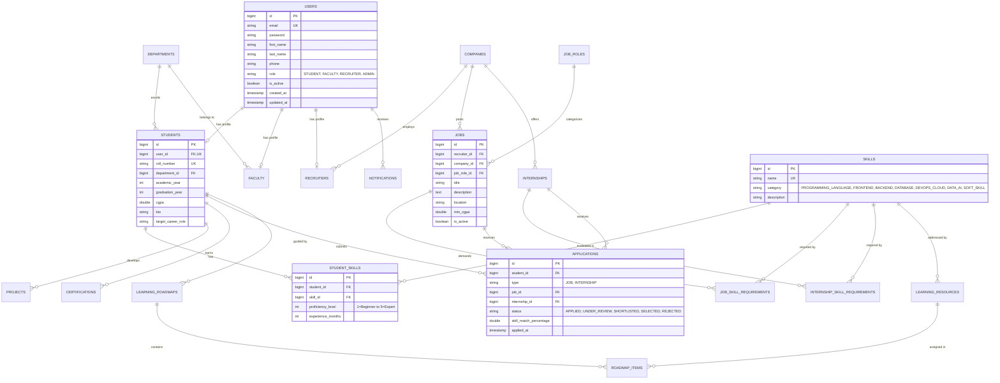

# SkillBridge — Database Architecture & ER Diagram

This document describes the relational database design implemented in PostgreSQL for **SkillBridge: An AI-Driven Academia–Industry Collaboration Platform**.

## Entity Relationship (ER) Diagram

---

## Verified Tables in PostgreSQL 18.3 (`skillbridge_db`)

All 21 relational tables are created and indexed:

1. `users` — Unified authentication & account entity.
2. `departments` — Academic branches (CSE, IT, ECE, AI&DS, etc.).
3. `students` — Student profiles, CGPA, department, graduation year.
4. `faculty` — Department coordinators and placement officers.
5. `companies` — Partner companies and recruiters' organizations.
6. `recruiters` — Talent acquisition professionals associated with companies.
7. `skills` — Standardized skill taxonomy (Categories: Programming, Frontend, Backend, etc.).
8. `student_skills` — Student self-assessment & project-backed skills (1–5 scale).
9. `projects` — Portfolio projects linked to students.
10. `certifications` — Industry credentials (AWS, Oracle, HackerRank, etc.).
11. `job_roles` — Career categories (e.g. *Java Developer*, *Data Analyst*).
12. `jobs` — Full-time / part-time job postings.
13. `job_skill_requirements` — Weighted skill requirements for matching algorithms.
14. `internships` — Practical internship openings for students.
15. `internship_skill_requirements` — Weighted skill requirements for internships.
16. `applications` — Multi-status application pipeline with duplicate-prevention constraints.
17. `learning_resources` — Curated courses, docs, tutorials for skill gap closure.
18. `learning_roadmaps` — Personalized learning tracks for missing skills.
19. `roadmap_items` — Sequenced checklist items with completion status.
20. `notifications` — Role-based system notifications.
21. `audit_logs` — Administrative and security traceability logs.
